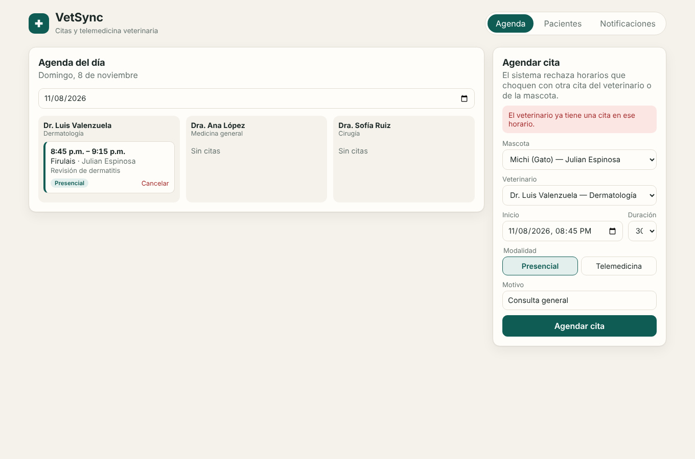
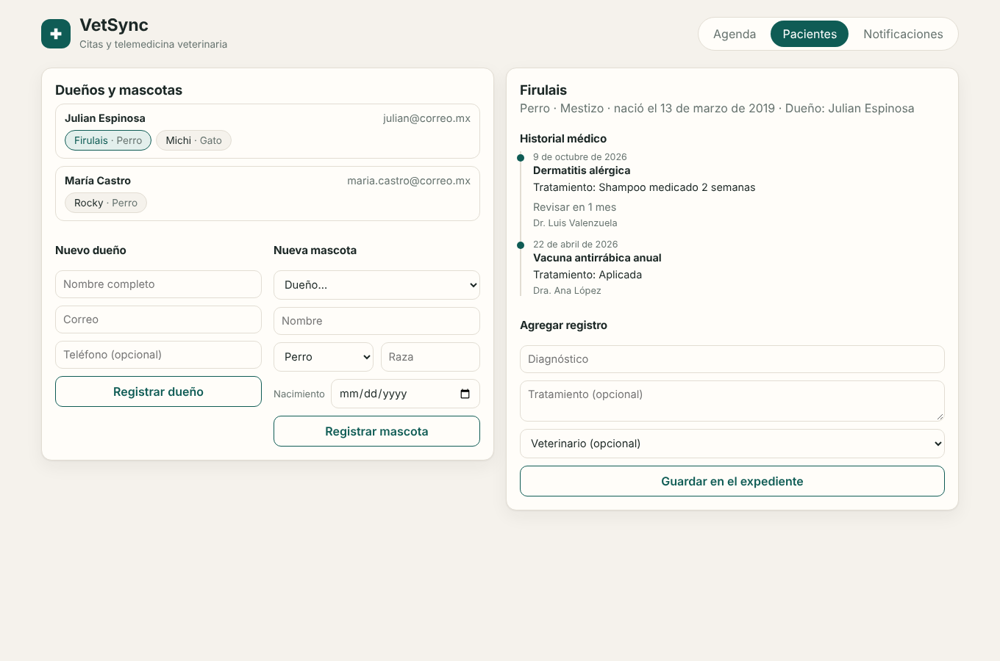
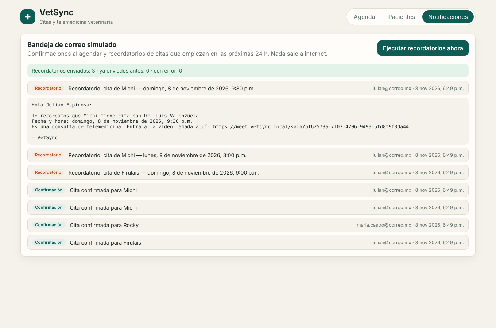

# VetSync — Gestión de citas y telemedicina veterinaria


Práctica de **Optativa I: Fundamentos de la IA en la Ingeniería de Software** (ITSON).
Desarrollada con un flujo humano‑IA: la IA escribió código y pruebas; el humano dirigió la
arquitectura, revisó cada sugerencia y rechazó o corrigió lo que no cumplía las reglas del proyecto.

| | |
|---|---|
| **Arquitectura** | Monolito modular desacoplado (4 módulos con puertos propios) |
| **Backend** | Node.js 22 · TypeScript estricto · Express 5 |
| **Frontend** | React 19 · Vite · TypeScript |
| **Pruebas** | TDD con `node:test` · 59 pruebas · cobertura de líneas 99.37 % |
| **Calidad** | SOLID verificado con pruebas de arquitectura · ESLint · CI en GitHub Actions |

## Requerimientos cubiertos

1. **Registro de mascotas y dueños con historial médico** — módulo `patients`.
2. **Agendamiento sin choques de horario** — módulo `appointments`: rechaza traslapes del veterinario y de la mascota, también bajo solicitudes simultáneas.
3. **Notificaciones simuladas por correo** — módulo `notifications`: confirmación al agendar y recordatorio 24 h antes, en una bandeja consultable.
4. **Restricción técnica** — modular, TDD (historial rojo → verde en los commits) y SOLID (ver [`docs/arquitectura.md`](docs/arquitectura.md)).

Extra: citas de **telemedicina** con enlace de videollamada simulado.

## Cómo correrlo

Requisitos: **Node.js 22.8 o superior**.

```bash
# 1) Backend (API en http://localhost:3000/api, con datos de demostración)
cd backend
npm install
npm run dev

# 2) Frontend (en otra terminal, abre http://localhost:5173)
cd frontend
npm install
npm run dev
```

El frontend redirige `/api` al backend, así que no hace falta configurar CORS.

### Scripts del backend

| Script | Qué hace |
|---|---|
| `npm run dev` | Servidor con recarga automática |
| `npm test` | Todas las pruebas |
| `npm run test:coverage` | Pruebas + reporte de cobertura; falla si las líneas bajan de 80 % |
| `npm run lint` | ESLint + verificación de tipos |

### Variables de entorno (todas opcionales)

| Variable | Defecto | Uso |
|---|---|---|
| `PORT` | `3000` | Puerto de la API |
| `SEED` | `true` | Cargar veterinarios, mascotas y citas de demostración |
| `REMINDER_INTERVAL_MS` | `60000` | Cada cuánto se buscan citas próximas |
| `REMINDER_LEAD_MINUTES` | `1440` | Con cuánta anticipación se manda el recordatorio |
| `DISPLAY_TIME_ZONE` | `America/Hermosillo` | Zona horaria de las fechas en los correos |

## Estructura

```text
backend/src/
├── shared/                 errores de dominio, Clock, IdGenerator, EventBus, KeyedMutex, validación
├── modules/
│   ├── patients/           dueños, mascotas, historial médico
│   ├── vets/               veterinarios
│   ├── appointments/       agendarCita, cancelación, telemedicina
│   └── notifications/      correo simulado, recordatorios, confirmaciones
│       └── (domain/ · application/ · infrastructure/ · public.ts)
├── http/                   app Express y middleware de errores
├── container.ts            raíz de composición (único lugar con implementaciones concretas)
└── main.ts                 arranque
```

Reglas que la IA debía respetar: [`AGENTS.md`](AGENTS.md).

## Documentación

| Documento | Contenido |
|---|---|
| [`docs/arquitectura.md`](docs/arquitectura.md) | Decisiones, diagramas Mermaid, esquema relacional y justificación SOLID |
| [`docs/schema.sql`](docs/schema.sql) | Esquema MySQL 8 |
| [`docs/api.md`](docs/api.md) | Endpoints, reglas de negocio y códigos de error |
| [`docs/informe-tests.md`](docs/informe-tests.md) | Resultados, historia TDD y cobertura por requerimiento |
| [`docs/code-review.md`](docs/code-review.md) | Revisión de seguridad y rendimiento con IA y lo que se corrigió |
| [`docs/bitacora-prompts.md`](docs/bitacora-prompts.md) | Los 5 prompts más importantes con su crítica |
| [`docs/reflexion-tecnica.md`](docs/reflexion-tecnica.md) | Reflexión sobre carga cognitiva y deuda técnica |

## Capturas

| Agenda y choque de horario | Historial médico | Correo simulado |
|---|---|---|
|  |  |  |

## Limitaciones conocidas

- Persistencia en memoria: los datos se reinician con el servidor. El esquema MySQL y los puertos están listos para un adaptador.
- Sin autenticación ni rate limiting (fuera del alcance de la práctica).
- El bloqueo contra agendamientos simultáneos protege una sola instancia del servidor; con varias, debe moverse a la base de datos (`SELECT … FOR UPDATE`).

---
**Equipo 6** — Julian Espinosa Llanos · Alejandro Erro González · Christian Daniel Valencia Patrón · Paul Candelario Seañez Villalobos · Ricardo Orduño Camacho  
Ingeniería en Software · ITSON
