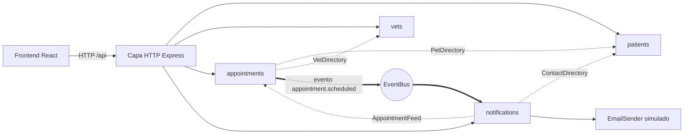
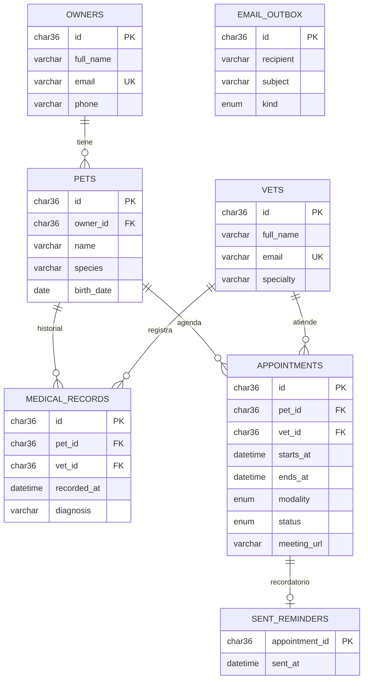

# Arquitectura de VetSync

## Decisión: monolito modular bien desacoplado

El caso permite microservicios o un monolito modular. Elegimos **monolito modular**
porque el dominio es pequeño (4 módulos) y el equipo es de una persona: los
microservicios agregarían red, despliegues independientes y consistencia eventual
sin un beneficio real hoy. A cambio, cada módulo se diseñó con sus propios puertos
para que extraerlo a un servicio sea mover una carpeta y cambiar un adaptador.



Las flechas punteadas son **puertos** (interfaces definidas por el módulo que las usa)
y se conectan en la raíz de composición (`container.ts`). Ningún módulo importa las
clases internas de otro: solo su `public.ts`. Una prueba de arquitectura lo verifica.

## Modelo de datos (MySQL)



Script completo: [`schema.sql`](./schema.sql).

Decisiones clave del esquema:

- **UUID (`CHAR(36)`) como llave**: los IDs se generan en la aplicación (puerto `IdGenerator`), lo que permite crear la entidad completa antes de persistirla y facilita una futura separación en servicios sin colisiones de autoincrementales.
- **`ends_at` almacenado** (no solo duración): la consulta de choques `starts_at < :fin AND ends_at > :inicio` usa el índice compuesto `(vet_id, status, starts_at, ends_at)` sin calcular columnas.
- **Choques de horario**: MySQL no tiene restricciones de exclusión por rango, así que la regla vive en el caso de uso y se serializa por veterinario (mutex en memoria; `SELECT … FOR UPDATE` sobre la fila del veterinario en MySQL).
- **`sent_reminders` separado de `appointments`**: notificaciones no escribe en tablas de otro módulo.
- **Historial médico de solo inserción**: un diagnóstico no se edita, se agrega uno nuevo (trazabilidad clínica).

## Estructura de carpetas

```text
vetsync/
├── AGENTS.md                  # reglas para la IA (Fase 1.2)
├── .github/workflows/ci.yml   # lint + tests + cobertura ≥ 80 %
├── docs/                      # arquitectura, esquema, API, informe de tests, bitácora
├── backend/
│   ├── src/
│   │   ├── shared/            # kernel compartido: errores, Clock, IdGenerator, EventBus, KeyedMutex
│   │   ├── modules/
│   │   │   ├── patients/      # dueños, mascotas, historial médico
│   │   │   │   ├── domain/
│   │   │   │   ├── application/   # casos de uso + puertos
│   │   │   │   ├── infrastructure/ # repos en memoria, rutas HTTP
│   │   │   │   └── public.ts      # única puerta de entrada para otros módulos
│   │   │   ├── vets/
│   │   │   ├── appointments/
│   │   │   └── notifications/
│   │   ├── http/              # app Express, middleware de errores
│   │   ├── container.ts       # raíz de composición (único lugar con `new` de infraestructura)
│   │   ├── seed.ts            # datos de demostración
│   │   └── main.ts            # arranque del servidor y del programador de recordatorios
│   └── test/                  # espejo de src/, una carpeta por módulo
└── frontend/                  # React + Vite + TypeScript
```

### Justificación con SOLID y escalabilidad

| Decisión | Principio | Por qué |
|---|---|---|
| Un caso de uso por clase (`ScheduleAppointment`, `CancelAppointment`) | S | Cada clase cambia por una sola razón de negocio. |
| Modalidad de cita y canal de notificación detrás de puertos (`MeetingRoomProvider`, `EmailSender`) | O | Agregar WhatsApp o Zoom es una nueva clase, no editar el caso de uso. |
| Repositorios en memoria y MySQL comparten la misma interfaz | L | Las pruebas contra la versión en memoria valen para cualquier implementación. |
| `PetDirectory` solo expone `exists()`; `ContactDirectory` solo el contacto | I | Citas no ve el historial médico; notificaciones no ve diagnósticos. |
| Casos de uso reciben interfaces por constructor; `Clock` inyectado | D | Pruebas deterministas y la infraestructura se cambia sin tocar el dominio. |
| Comunicación entre módulos por eventos (`appointment.scheduled`) | Bajo acoplamiento | Citas no sabe que existe el módulo de correo. |
